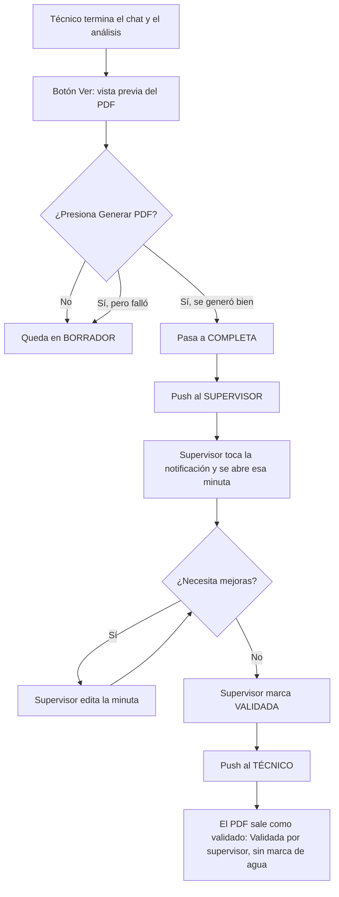

# Vista previa, estados, validación y edición de la minuta

Última actualización: 2026-10-11 (sobre la versión 0.0.3). Especificación definida por el equipo; **no implementada**.

> ⛔ Solo especificación. Se implementa en una rama local y se prueba en local. **No se sube nada a `main` ni a producción** sin aprobación del equipo.


> **Regla visual de toda la app (confirmada 2026-10-11):** los menús, hojas inferiores, diálogos, botones, chips, burbujas del chat, cabeceras y tarjetas **mantienen la forma visual actual**; solo se agregan las opciones nuevas dentro de esas mismas piezas. Referencia en el código: hoja "Agregar al mapa" y menú de un equipo (`TopologyEditorFragment`: título 18 bold, filas con ícono en cuadro de 42 dp y radio 14, diálogos de 28 dp de radio), respuestas rápidas y chips del chat (`TechnicalChatFragment`: contorno azul #1565C0, radio 18, 36 dp; marcado = relleno azul), burbujas `bg_chat_bot` / `bg_chat_user`, tarjetas `bg_home_card` (radio 22) y botones de la propuesta (radio 18, 52/56 dp). La maqueta "Asistente de Red — maqueta de la lógica nueva" sigue esta regla.

---

## 1. Lo que hay hoy (revisión del código, solo lectura)

| Tema | Hoy | Dónde |
|---|---|---|
| Estados | BORRADOR → COMPLETA → VALIDADA ya existen. El supervisor valida con `POST /api/minutas/{id}/validar` (solo rol SUPERVISOR) | Gateway `minuta/MinutaStatus.java`, `MinutaService.java` |
| Pasar a COMPLETA | Es un botón manual en la **lista de minutas**. **No** depende de generar el PDF | Android `MinutasListViewModel.complete()` |
| Aviso al supervisor | Al completar, el gateway envía un push a todos los supervisores ("…completó la minuta de X. Está lista para validar") | `notification/MinutaNotifier.minutaCompleted` |
| Abrir la minuta desde la notificación | **No existe**: el push solo trae título y texto. Al tocarlo se abre la app, no la minuta | Android `PushMessagingService` |
| Aviso al técnico al validar | **No existe**: `validate()` no envía push | `MinutaService.validate` |
| Compartir por WhatsApp | El botón está **siempre activo**, sin importar el estado | Android `PdfPreviewFragment` (`btnWhatsapp`) |
| Vista previa antes del PDF | **No existe**: solo se ve el PDF después de generarlo | `MinutaProposalFragment` → `PdfPreviewFragment` |
| Aviso de "sin verificar" en el PDF | **No existe** | Plantilla `templates/minuta.html` del gateway |
| Editar datos | Un botón **Editar** con 5 campos: establecimiento, dirección, contacto, teléfono y notas. **Lo editado no llega al PDF**: el PDF se arma con las respuestas del chat (`MinutaPdfService` → FastAPI `/chat/minuta-document`), no con la tabla `minutas` | Android `EditProposalFragment`; gateway `pdf/MinutaPdfService.java` |
| Recomendaciones y pasos a seguir | No se pueden editar. `ProposalController` del gateway es de prueba: devuelve datos fijos y no guarda nada | `proposal/ProposalController.java` |
| RUC y correo del encargado | No se preguntan ni se guardan | Flujo de 76 nodos y entidad `Minuta` |

---

## 2. Flujo nuevo



### 2.1 Botón "Ver" (vista previa)
- En la pantalla de la propuesta, antes de **Generar PDF**, hay un botón **Ver**.
- Muestra la minuta como quedará en el PDF (mismo documento y plantilla) con la marca **"VISTA PREVIA"**.
- **No cambia el estado** ni guarda el PDF.

### 2.2 Generar PDF → COMPLETA
- Al presionar **Generar PDF**: si el PDF se genera bien, la minuta pasa de **BORRADOR a COMPLETA** en la misma operación.
- Si no se genera (por ejemplo, falta una evidencia obligatoria), queda en **BORRADOR** y se muestra el motivo.
- Volver a generar el PDF de una minuta que ya está COMPLETA no envía otra notificación (el gateway ya lo controla con `wasCompleted`).
- El botón **Completar** de la lista de minutas se quita, porque ahora se completa al generar el PDF.

### 2.3 Notificación al supervisor
- Push a todos los usuarios con rol **SUPERVISOR**: "{técnico} completó la minuta de {local}. Está lista para validar."
- El push lleva datos para abrir la minuta: `{"tipo": "MINUTA_COMPLETA", "minutaId": …, "evaluationId": …}`.
- Al tocarla, la app abre **esa minuta** en la pantalla de la propuesta, en estado COMPLETA.

### 2.4 Qué puede hacer cada rol

| Acción | Técnico | Supervisor |
|---|---|---|
| Ver (vista previa), generar y descargar el PDF | ✅ | ✅ |
| Editar (las 3 opciones de la sección 3) | ✅ en BORRADOR | ✅ en BORRADOR y COMPLETA |
| Pasar de COMPLETA a **VALIDADA** | ❌ | ✅ (botón **Validar** en la pantalla de la minuta, además de la lista) |
| **Compartir por WhatsApp y por correo** | ✅ siempre (con PDF generado) | ✅ siempre (con PDF generado) |

### 2.5 Validación → notificación al técnico
- Al validar, push al técnico que hizo la minuta (`technicianId`): "{supervisor} validó la minuta de {local}. El PDF ya sale sin la marca de agua SIN VALIDAR."
- Datos: `{"tipo": "MINUTA_VALIDADA", "minutaId": …, "evaluationId": …}`. Al tocarla se abre esa minuta.

### 2.6 Compartir por WhatsApp y por correo (actualizado 2026-10-11)
- **Se quita la regla anterior** que bloqueaba WhatsApp hasta la validación.
- Compartir por **WhatsApp** y por **correo** están **siempre activos** una vez generado el PDF, en cualquier estado.
- Si la minuta no está VALIDADA, se comparte como **no verificada** (ver 2.7). La app muestra: "Aún no está validada: se comparte por WhatsApp o correo como no verificada, con la marca de agua SIN VALIDAR".

### 2.7 PDF descargado sin validar
- Si la minuta **no está VALIDADA** (BORRADOR o COMPLETA), el PDF sale como **no verificado**:
  - **Marca de agua "SIN VALIDAR"** en diagonal, en todas las páginas.
  - En Datos generales, **Validada por: "No verificada: sin validar por el supervisor"** (sin nombre de persona).
- Cuando está VALIDADA, desaparece la marca de agua y se muestra "Validada por {supervisor}".

---

## 3. Botón "Editar": 3 opciones

Al presionar **Editar** aparece un menú:

1. **Datos principales:** razón social, **RUC** (11 dígitos), nombre del local, dirección, persona encargada, **celular del encargado** (9 dígitos), **correo del encargado**, técnico y fecha de la visita. Este cambio no recalcula el análisis.
2. **Información de la visita:** las respuestas del chat agrupadas por bloque (negocio, internet, cajas, impresoras, energía, cableado, WiFi), cada una con sus mismas opciones (incluido "Otro" para escribir) y la opción de cambiar una foto. Si el cambio afecta el análisis, se recalculan análisis, recomendaciones y mapa, con aviso antes de hacerlo.
3. **Datos del análisis:** recomendaciones (editar, quitar, agregar, prioridad), pasos a seguir (cliente / ID), observaciones y anexos de video. Lo editado queda marcado como "editado por el técnico" y no se pierde si el análisis se recalcula.

**Para que la edición llegue al PDF:**
- Todas las ediciones se guardan en la evaluación, en un campo nuevo `minuta_ediciones_json` con tres partes: `datosPrincipales`, `respuestas` y `analisis`.
- `MinutaPdfService` envía esas ediciones a FastAPI junto con el estado del chat, y `build_minuta_document` las aplica antes de armar el documento.
- La tabla `minutas` se sincroniza (nombre, contacto, teléfono), para que la lista de minutas muestre los datos corregidos.

### 3b. Otras formas de corregir (confirmado 2026-10-11)

**Hoy:** al leer una evidencia aparecen "Sí, es correcto", "Corregir" y "Cambiar foto", pero solo en ese momento. Al terminar el chat, el texto libre solo cambia el **mapa** ("Pide un cambio al mapa…").

1. **Tocar un mensaje del chat para corregirlo.** Cada resumen de una evidencia (por ejemplo: "Visualizo una impresora Epson, por red, SN …, ubicada en Cocina, lugar de preparación Cocina") se puede tocar en cualquier momento. Se editan sus datos (marca, conexión, IP, SN, ubicación, área) y al guardar se actualizan las respuestas, el análisis, el mapa y la minuta. El mensaje queda marcado "corregido por el técnico".
2. **Pedir cambios a la minuta desde el chat.** Al terminar, el campo dice "Pide un cambio a la minuta…". Ejemplos: "la IP de la impresora de cocina es 192.168.1.40", "agrega en pasos a seguir que el cliente enviará la carta el lunes". El asistente lo aplica a la minuta (y al mapa si corresponde) y responde qué cambió; el técnico puede deshacerlo.
3. **Editar en la vista previa (Ver), antes del PDF.** Botón **Editar minuta** y, en el documento, todo lo que dice "no legible" o "sin dato" (por ejemplo, la IP o el modelo de "Impresora Epson Cocina" en el cuadro técnico) se resalta como **Completar**: al tocarlo se escribe el dato ahí mismo.

Todo se guarda en `minuta_ediciones_json`, sale en el PDF y no se pierde si el análisis se recalcula.

---

## 4. Cambios por repositorio

| Repo | Cambio |
|---|---|
| **Gateway** | 1) `GET /api/evaluations/{id}/minuta/pdf?preview=true`: arma el PDF con marca "VISTA PREVIA", sin cambiar el estado. 2) Sin `preview`: si el PDF se genera bien, llama a `MinutaService.complete()`. 3) `MinutaNotifier.minutaValidated()`: push al técnico; los dos push llevan `tipo`, `minutaId` y `evaluationId`. 4) Plantilla `minuta.html`: franja "Esta minuta se emitió sin ser verificada" si el estado no es VALIDADA. 5) Endpoint para compartir: rechaza (403) si no está VALIDADA. 6) Entidad: campos `ruc`, `contactEmail`, `visitDate` en `Minuta` y `minuta_ediciones_json` en `Evaluation`; `PUT /api/minutas/{id}` con los datos principales y `PUT /api/evaluations/{id}/minuta-ediciones` para las ediciones. 7) Permisos: supervisor puede editar en COMPLETA; técnico solo en BORRADOR |
| **FastAPI** | `/chat/minuta-document` recibe `ediciones` y las aplica: datos principales sobre P01–P07 (y RUC y correo), respuestas editadas sobre el estado, y recomendaciones y pasos a seguir editados sobre el resultado de las reglas |
| **Android** | 1) Botón **Ver** (vista previa) antes de **Generar PDF**. 2) Generar PDF refresca el estado a COMPLETA. 3) `PushMessagingService`: `PendingIntent` con `minutaId`/`evaluationId` que abre la propuesta de esa minuta. 4) Botón **Validar** en la pantalla de la minuta para el supervisor. 5) WhatsApp desactivado si no está VALIDADA, con el mensaje. 6) **Editar** abre el menú de 3 opciones; `EditProposalFragment` pasa a ser "Datos principales" con todos los campos. 7) Quitar **Completar** de la lista |

**Ojo con producción:** la base de producción tiene una restricción (CHECK) en los estados de la minuta y el gateway usa `ddl-auto=update`. Los campos nuevos se agregan solos, pero cualquier cambio de enum requiere una migración manual. Probar todo con Postgres local.

---

## 5. Por confirmar con el equipo

1. ¿RUC y correo del encargado se agregan como preguntas opcionales del chat, o solo se llenan en "Datos principales"?
2. En "Información de la visita", si el cambio altera la estructura (rubro, áreas, número de cajas o impresoras), ¿se reabre el chat desde esa pregunta?
3. Si se edita una minuta **VALIDADA**, ¿vuelve a COMPLETA y hay que validarla otra vez?
4. ¿El técnico puede editar su minuta mientras está COMPLETA, o desde ahí solo edita el supervisor? *(Supuesto en la tabla 2.4: solo el supervisor.)*

---

## 6. Prompt para Claude Code

```
Lee docs/analisis/EDICION_Y_ESTADOS_MINUTA.md.
REGLAS: no hagas push a main ni toques producción (Railway despliega main solo); trabaja en la rama local
feature/estados-y-edicion-minuta y prueba con Postgres local. Muéstrame el diff y los tests antes de cualquier commit.
1. Gateway: vista previa (?preview=true, sin cambio de estado), completar al generar el PDF, push al técnico al validar,
   datos tipo/minutaId/evaluationId en los push, marca de agua "SIN VALIDAR" y "Validada por: No verificada" si no está VALIDADA,
   compartir permitido en cualquier estado, campos ruc/contactEmail/visitDate y minuta_ediciones_json, permisos por rol.
2. FastAPI: /chat/minuta-document acepta "ediciones" y las aplica antes de armar el documento. Tests con un estado de ejemplo.
3. Android: botón Ver, estado tras generar el PDF, PendingIntent que abre la minuta desde la notificación, botón Validar
   para supervisor, WhatsApp y correo siempre activos, menú Editar con 3 opciones; quitar Completar de la lista.
4. Tests: generar PDF → COMPLETA y push a supervisores; validar → push al técnico; PDF sin validar con la marca de agua;
   compartir sin validar → permitido; edición de datos principales visible en el PDF.
```

## 7. Propuesta técnica y edición desde el chat (actualizado 2026-10-11)
- **Barra de acciones** compacta: Ver · Editar · Guardar · WhatsApp · Compartir (ícono sobre fondo suave y nombre debajo). Encima, el botón principal Generar PDF (o Validar minuta para el supervisor).
- **Lápiz (Editar):** Editar propuesta técnica · Corregir una lectura de evidencia · Pedir un cambio en el chat.
- **Editar propuesta técnica:** por apartado: Datos del local, Topología (editor del mapa), Equipamiento recomendado (equipo y cantidad), Diagnóstico AS-IS, Propuesta TO-BE (título y detalle), Observaciones. Se puede quitar o agregar; las recomendaciones editadas salen en el PDF. Opción "Volver a la propuesta generada por la IA".
- **Menú ⋮:** Ver mapa de red · Editar propuesta técnica · Corregir una lectura de evidencia · Pedir un cambio en el chat · Observaciones · **Compartir a** (reemplaza "Enviar por correo"): hoja de compartir de Android (Intent.ACTION_SEND con el PDF) con las apps instaladas.
- **Editar respuestas en el chat** (evaluación terminada): al tocar una respuesta se abre solo esa pregunta (texto, opción o evidencia), sin volver a preguntar las siguientes. Al responder: **Guardar y salir** (vuelve a la conversación para revisar otras respuestas) o **Solo salir** (descarta ese cambio). Banner "Modo edición" con los cambios sin guardar. Al final, **Continuar con diagnóstico** guarda todos los cambios y recalcula análisis, mapa y minuta (si el PDF ya estaba generado, hay que volver a generarlo). Si el cambio hace aparecer preguntas nuevas, se responden antes de continuar. Salir del chat con cambios pendientes pregunta: Descartar y salir · Seguir editando · Continuar con diagnóstico.


## 8. Vista previa y Propuesta PDF: hojas, compaginado y zoom (confirmado 2026-10-11)

- **Hojas A4 como el PDF:**
  - Mismos márgenes que el PDF: 24 mm arriba, 18 mm abajo y 15 mm a los lados.
  - Cabecera con el nombre de la minuta y pie "Página n de N".
  - El anexo empieza en hoja nueva.
  - Las tablas se cortan entre filas. Un título no queda solo al pie de la hoja.
  - En el simulador, las 5 minutas de ejemplo dan el mismo número de hojas que su PDF (7, 8, 8, 6 y 5).
- **Compaginado:** barra "‹ Página n de N ›". También se puede deslizar a los lados cuando no hay zoom.
- **Desplazamiento:** la hoja se ajusta al ancho de la pantalla. Si no entra entera, se desliza hacia abajo para leerla completa.
- **Zoom:**
  - Pellizcar con dos dedos, doble toque, o los botones − y +. Va de 100 % a 400 %.
  - Con zoom se desplaza en las dos direcciones.
  - En la app Android:
    - Usar un visor de PDF con zoom (`PdfRenderer` + `PhotoView`/`SubsamplingScaleImageView`, o `androidx.pdf`).
    - Una página por vista: `ViewPager2`, desactivando el deslizamiento cuando hay zoom.
    - Mostrar el contador "Página n de N".
- **Marcas en cada hoja:** "SIN VALIDAR" (o "VISTA PREVIA" antes de generar el PDF) aparece en todas las hojas, no solo en la primera.

## 9. Eliminar una lectura de una evidencia (confirmado 2026-10-11)

- En "Esto leí en la captura", cada lectura tiene a su lado una **X roja**.
- **Al tocarla:**
  - La lectura se quita y no aparece en el chat, en la minuta ni en el anexo.
  - Queda registrada en `data._del`. Las reglas la tratan como dato no leído.
  - Por ejemplo, sin la IP del selftest, la impresora queda como "IP sin dato".
- **Restaurar** devuelve lo que leyó la IA.
- Si se eliminan todas, la foto queda como evidencia sin datos leídos.
